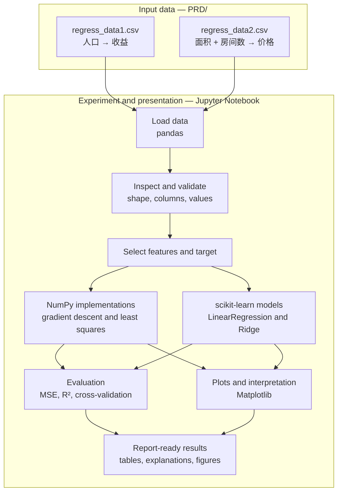

# Project Architecture

## Overview

This project is an educational, notebook-based linear-regression experiment. The Jupyter Notebook is the application and presentation layer: it loads the supplied CSV datasets, explores and validates them, runs regression algorithms, evaluates and visualizes results, and provides material for the experiment report. There is no separate web service, database, or deployment tier.

## High-level architecture

## Components and responsibilities

| Component | Responsibility | Technology |
| --- | --- | --- |
| Input datasets | Provide the univariate population/revenue data and multivariable housing data. | CSV files in `PRD/` |
| Notebook orchestration | Present the experiment in a reproducible, sequential workflow and explain each step. | Jupyter Notebook, Python |
| Data loading and validation | Load data, inspect dimensions and columns, and reject missing or non-numeric model inputs before fitting. | pandas |
| From-scratch algorithms | Implement and compare univariate batch gradient descent and least squares. | NumPy |
| Estimator demonstrations | Fit simple and multivariable linear regression; compare Ridge regularization strengths. | scikit-learn |
| Evaluation and validation | Report explicitly labeled training/validation/test metrics and compare candidate parameters on consistent folds. | scikit-learn metrics, cross-validation, pipelines |
| Visualization | Show observed data, fitted models, training cost, and validation results with labeled axes. | Matplotlib |
| Experiment deliverables | Present outputs, interpretations, and figures for the student's report. | Notebook markdown, tables, plots |

## Data and model flows

### Univariate regression

1. Load `PRD/regress_data1.csv`.
2. Validate and select `人口` as the feature and `收益` as the target.
3. Fit NumPy batch gradient descent and a stable NumPy least-squares solution on the same observations and intercept convention.
4. Fit scikit-learn `LinearRegression` on the same feature and target.
5. Compare coefficients, predictions, and clearly labeled evaluation metrics.
6. Plot the observations, fitted line, and gradient-descent cost history.

### Multivariable regression

1. Load `PRD/regress_data2.csv`.
2. Validate and select `面积` and `房间数` as features and `价格` as the target.
3. Fit scikit-learn linear regression and report the intercept and named feature coefficients.
4. Evaluate regularization candidates using consistent, reproducible validation folds. Put any learned preprocessing inside a scikit-learn `Pipeline` so each fold learns it from its training partition only.
5. Present validation results and an interpretation suitable for the experiment report.

## Design decisions

- **Notebook-first:** The educational workflow, explanation, code, and outputs belong together. A packaged application architecture would add complexity without serving the stated requirements.
- **Supplied data is authoritative by default:** Use the two CSV files in `PRD/`; do not substitute the Boston housing dataset without confirmation.
- **Explicit feature and target selection:** Keep the Chinese column names and feature roles visible in notebook results.
- **One intercept convention per model:** NumPy models may explicitly include a bias column; scikit-learn estimators should use their fitted intercept without an unintended duplicate constant feature.
- **Leakage-safe validation:** Fit learned preprocessing within cross-validation folds using pipelines.
- **Reproducible execution:** Resolve input paths relative to the notebook/project location and use a fixed seed for randomized splits.

## Runtime and dependencies

The selected environment is Python 3.11 with Jupyter, NumPy, pandas, Matplotlib, and scikit-learn. See [TECH_STACK.md](./TECH_STACK.md) for the selected stack and installation guidance.

## Current implementation gaps

The architecture describes the intended complete workflow. The notebook remains a partial implementation: its CSV paths currently point to a missing `data/` location, the required scikit-learn multivariable model is missing, validation preprocessing needs to be made leakage-safe, and the least-squares code should use a stable solver instead of explicitly inverting a matrix. See [FEATURE_REQUIREMENTS.md](./FEATURE_REQUIREMENTS.md) for acceptance criteria and completion status.
